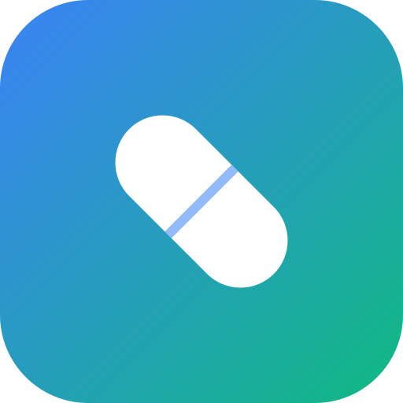

<div align="center">



# HomeMed

**A farmácia da sua casa, organizada.**
Controle medicamentos, validades e estoque, com identificação por foto e código de barras usando IA.

[](https://nextjs.org/)
[](https://www.mongodb.com/atlas)
[](https://capacitorjs.com/)
[](#-app-android)
[](#-licença)

[Acessar o app](https://www.homemed.tech) · [Política de Privacidade](https://www.homemed.tech/privacy) · [Termos de Uso](https://www.homemed.tech/terms)

</div>

---

## 📋 Sumário

- [Sobre o projeto](#-sobre-o-projeto)
- [Funcionalidades](#-funcionalidades)
- [Stack](#-stack)
- [Primeiros passos](#-primeiros-passos)
- [Variáveis de ambiente](#-variáveis-de-ambiente)
- [Login com Google](#-login-com-google)
- [Notificações de vencimento](#-notificações-de-vencimento)
- [Deploy em produção](#-deploy-em-produção)
- [App Android](#-app-android)
- [Backup do banco](#-backup-do-banco)
- [Testes](#-testes)
- [Estrutura do projeto](#-estrutura-do-projeto)
- [Licença](#-licença)

## 💊 Sobre o projeto

O HomeMed ajuda famílias a saber o que têm na farmácia de casa: o que está
perto de vencer, o que já venceu e o que está acabando. É construído em
**Next.js 15** (App Router) com **MongoDB** e também empacotado como **app
Android** via Capacitor, que carrega o site publicado. Por isso, mudanças no
site chegam ao app sem precisar de uma nova versão na loja.

## ✨ Funcionalidades

| Área | O que faz |
|---|---|
| **Cadastro inteligente** | Identifica o medicamento por foto ou código de barras com o Google Gemini |
| **Controle de validade e estoque** | Destaca o que vence em breve, o que já venceu e o que está com pouco estoque |
| **Avisos de vencimento** | Lembretes no celular, com dias de antecedência e horário configuráveis |
| **Assistente de inventário** | Pergunte em linguagem natural o que você tem em casa |
| **Compartilhamento familiar** | Uma farmácia compartilhada entre os membros da família, por código de convite |
| **Exportação** | Relatórios em PDF, Excel (`.xlsx`) e CSV |
| **Contas** | Cadastro por e-mail e senha ou Google, recuperação de senha por e-mail e exclusão de conta |
| **Tema** | Modo claro e escuro |

## 🧰 Stack

| Camada | Tecnologia |
|---|---|
| Frontend | Next.js 15 (App Router), React 18, Tailwind CSS, shadcn/ui |
| Backend | Rotas de API em `app/api/[[...path]]/route.js` |
| Banco de dados | MongoDB Atlas (`lib/mongo.js`) |
| IA | Google Gemini (`lib/ai.js`) |
| E-mail | Resend (recuperação de senha) |
| Mobile | Capacitor 6 (Android), login nativo do Google e notificações locais |
| Hospedagem | Vercel, com build do Android no GitHub Actions |

## 🚀 Primeiros passos

**Pré-requisitos:** Node.js 20+, Yarn e uma conta no MongoDB Atlas.

```bash
# 1. Instale as dependências
yarn install

# 2. Crie o arquivo de ambiente e preencha (veja a tabela abaixo)
cp .env.example .env

# 3. Suba o servidor de desenvolvimento
yarn dev
```

O app sobe em `http://localhost:3000`.

## 🔐 Variáveis de ambiente

Copie `.env.example` para `.env` e preencha:

| Variável | Obrigatória | Descrição |
|---|:---:|---|
| `MONGO_URL` | Sim | Connection string do MongoDB Atlas (Connect → Drivers → Node.js) |
| `DB_NAME` | Sim | Nome do banco (padrão: `homemed`) |
| `SENTRY_DSN` | Não | Endereço do projeto no Sentry para registrar erros do servidor (sem dados pessoais) |
| `NEXT_PUBLIC_DOSE_REMINDERS` | Não | `true` liga o lembrete de horário de tomar ("Doses de hoje"). Desligado por padrão. É lida na compilação: depois de mudar, faça um novo deploy |
| `GEMINI_API_KEY` | Sim | Chave da API do [Google AI Studio](https://aistudio.google.com/apikey) |
| `GOOGLE_CLIENT_ID` | Para login Google | ID do cliente OAuth do Google |
| `GOOGLE_CLIENT_SECRET` | Para login Google | Chave secreta do mesmo cliente OAuth |
| `RESEND_API_KEY` | Para e-mails | Chave do [Resend](https://resend.com). Sem ela o app funciona, mas o e-mail de recuperação de senha não é enviado |
| `EMAIL_FROM` | Para e-mails | Remetente, por exemplo `HomeMed <nao-responda@homemed.tech>`. O domínio precisa estar verificado no Resend |
| `EMAIL_REPLY_TO` | Não | Para onde vão as respostas aos e-mails automáticos (padrão: `suporte@homemed.tech`) |
| `APP_URL` | Para e-mails | Endereço público do site, usado para montar o link do e-mail |
| `CORS_ORIGINS` | Não | Origens permitidas nas rotas `/api/*` |
| `FRAME_ANCESTORS` | Não | Origens permitidas a enquadrar o app em iframe |

> [!WARNING]
> Nunca commite o `.env`: ele já está no `.gitignore`. Em produção, defina as
> variáveis direto no painel da hospedagem.

## 🔑 Login com Google

O botão "Continuar com Google" usa um fluxo OAuth 2.0 implementado nas próprias
rotas de API (`/api/auth/google` e `/api/auth/google/callback`), sem serviço de
terceiros. No app Android, o login é nativo (Credential Manager, via
`@capgo/capacitor-social-login`) e o token é verificado em `/api/auth/google/token`.

<details>
<summary><b>Como configurar no Google Cloud Console</b></summary>

1. No [Google Cloud Console](https://console.cloud.google.com/apis/credentials),
   crie (ou reutilize) um projeto e vá em **APIs e Serviços → Credenciais**.
2. **Criar credenciais → ID do cliente OAuth**, tipo **Aplicativo da Web**.
3. Em **URIs de redirecionamento autorizados**, adicione uma linha para cada
   domínio onde o app roda, por exemplo:
   - `https://www.homemed.tech/api/auth/google/callback`
   - `https://homemed-prod-uqag.vercel.app/api/auth/google/callback` (domínio da Vercel, útil para testes)
   - `http://localhost:3000/api/auth/google/callback` (desenvolvimento local)
4. Copie o **Client ID** e o **Client Secret** para `GOOGLE_CLIENT_ID` e
   `GOOGLE_CLIENT_SECRET`.
5. Em **Tela de consentimento OAuth**, preencha o nome do app, o e-mail de
   suporte e o link da política de privacidade (`/privacy`). Como o app só usa
   os escopos básicos (`openid email profile`), não é necessária verificação do
   Google: basta marcar o app como "Em produção" para não ficar limitado a
   usuários de teste.

</details>

## 🔔 Notificações de vencimento

Em **Configurações** (ícone de engrenagem), cada pessoa escolhe:

- ligar ou desligar os avisos de vencimento;
- com quanto tempo de antecedência ser avisada: 30, 15, 7, 3 ou 1 dia antes, ou no dia;
- o horário do aviso, das 06:00 às 22:00.

No app Android, os avisos são agendados **no próprio celular** com
`@capacitor/local-notifications`, então chegam com o app fechado, sem servidor
de push. Quando há vários remédios no mesmo dia, eles vêm numa única
notificação. No navegador, os avisos aparecem quando o app é aberto. As
preferências ficam salvas na conta (`GET` e `PUT /api/settings`).

## ☁️ Deploy em produção

1. Importe este repositório em [vercel.com/new](https://vercel.com/new).
2. Em **Environment Variables**, adicione as variáveis da tabela acima.
3. Clique em **Deploy**. O `next.config.js` já traz `output: 'standalone'` e
   cabeçalhos de segurança (CSP, CORS etc.).
4. Depois do primeiro deploy, ajuste `CORS_ORIGINS` e `FRAME_ANCESTORS` para a
   URL final de produção, em vez de `*`.

## 🤖 App Android

O projeto nativo fica em `/android` (pacote `com.blessahome.homemed`). O app
carrega o site publicado (`server.url` em `capacitor.config.js`):

| Tipo de mudança | O que fazer |
|---|---|
| Código do site, estilos, rotas de API | Só publicar na Vercel. O app já recebe |
| Plugin nativo, `build.gradle`, ícones ou permissões | Gerar um novo `.aab` e aumentar o `versionCode` em `android/app/build.gradle` |

**Gerando o `.aab` de release:** abra a aba **Actions** do GitHub, escolha
**Android Release Build** e clique em **Run workflow**. Ao terminar, baixe o
artefato `homemed-release-aab` e envie no Google Play Console.

**Para abrir no Android Studio:**

```bash
yarn install
npx cap sync android
npx cap open android
```

## 💾 Backup do banco

O workflow **Database Backup** (`.github/workflows/db-backup.yml`) roda todo dia às 03:17 (Brasília) e também sob demanda em *Actions → Database Backup → Run workflow*. Ele faz um `mongodump`, criptografa com AES-256 e guarda o arquivo como artifact por 90 dias.

Secrets necessários (*Settings → Secrets and variables → Actions*): `MONGO_URL` e `BACKUP_PASSPHRASE`. O backup copia todos os bancos do cluster, então o nome do banco não é necessário.

Para restaurar:

```bash
gpg --decrypt homemed-backup-AAAA-MM-DD_HHMM.tar.gpg > dump.tar
tar -xf dump.tar   # gera a pasta dumps/ com um arquivo por banco
mongorestore --uri="$MONGO_URL" --gzip --archive=dumps/NOME_DO_BANCO.archive.gz --nsFrom="NOME_DO_BANCO.*" --nsTo="homemed_restore.*"
```

Restaure primeiro num banco separado (`homemed_restore`) e confira os dados antes de copiar para o banco de produção.

## 🧪 Testes

```bash
yarn test
```

Roda os testes (Vitest) das regras que mais importam: status de validade, plano de notificações, lembretes de dose, lista de viagem, limite de tentativas e índices do banco. Há também testes da API que chamam a rota de verdade sobre um banco falso em memória (`tests/helpers/fake-db.js`): cadastro, login, bloqueio por tentativas, recuperação de senha, exclusão de conta, isolamento entre usuários e família. Ficam em `tests/unit/`. O script já fixa o fuso `America/Sao_Paulo`.

A cada envio ao GitHub, o workflow **CI** (`.github/workflows/ci.yml`) roda os testes e compila o site.

## 🗂️ Estrutura do projeto

```text
app/
├── api/[[...path]]/    ponto de entrada da API (entrega cada rota ao módulo certo)
├── privacy/            Política de Privacidade
├── terms/              Termos de Uso
├── delete-account/     página pública de exclusão de conta
└── page.js             composição da aplicação (estado e fluxo principal)
components/app/         telas e diálogos (login, painel, cadastro, detalhes, família, conta, assistente)
components/             componentes de UI (shadcn/ui), configurações e leitor de código de barras
lib/api/                módulos da API: auth, famílias, medicamentos, IA e configurações
lib/data/               acesso aos dados (usuários e sessões, medicamentos e histórico, famílias)
lib/                    MongoDB, IA, exportação, notificações e utilitários
android/                projeto nativo do Capacitor
public/                 manifest PWA, service worker e ícones
.github/workflows/      build do app Android (.aab)
```

## 📄 Licença

**Licença de uso: privada.**

Este é um projeto proprietário. Todos os direitos são reservados a
**Vitor Blessa**. O código-fonte, o nome, a marca e os materiais do HomeMed
não podem ser copiados, modificados, distribuídos ou usados, no todo ou em
parte, sem autorização expressa e por escrito do autor.

Para falar sobre uso ou parcerias: [suporte@homemed.tech](mailto:suporte@homemed.tech).
